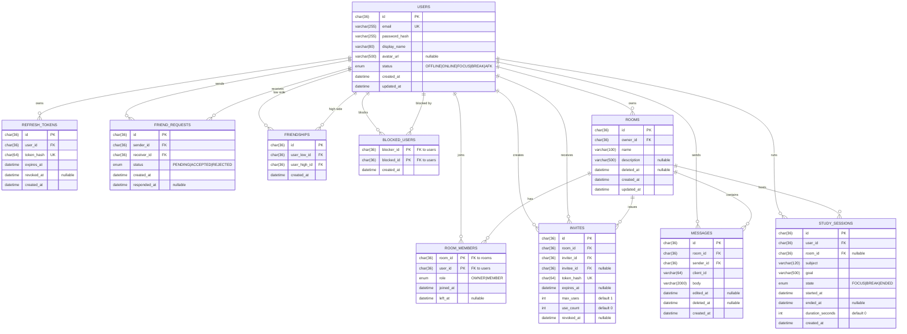

# StudySync — Entity Relationship Diagram (Baseline)

> Baseline ERD for MVP. Reflects the data model described in the Software Development Plan (section 11).
> Implementation source of truth: `backend/prisma/schema.prisma` (models added in M2+).

## Diagram

## Tables

| Table | Purpose |
|---|---|
| `users` | Account identity, credentials hash, profile fields, presence status. |
| `refresh_tokens` | Rotating refresh token family; only hashes stored. Cascade delete on user removal. |
| `friend_requests` | Directed pending request from sender to receiver. |
| `friendships` | Accepted friendship, stored once with canonical user ordering (`user_low_id < user_high_id`). |
| `blocked_users` | Directed block relationship; composite PK. |
| `rooms` | Private study room owned by a single user; soft-delete protects history. |
| `room_members` | Membership join table; `role` is `OWNER` or `MEMBER`; `left_at` supports history. |
| `invites` | Token-based invite; only token hash stored; supports expiry, max uses and revocation. |
| `messages` | Persisted room chat; `client_id` used for idempotent delivery. Soft-delete supported. |
| `study_sessions` | Personal study session per user; state machine `FOCUS → BREAK → FOCUS → ENDED`. |

## Key constraints and rules

- **Canonical ordering** for friendships: `user_low_id < user_high_id` + `UNIQUE(user_low_id, user_high_id)` prevents reverse-duplicate.
- **Cascade delete** on `refresh_tokens` when a user is removed.
- **No self-relation**: `friend_requests.sender_id <> receiver_id`; `blocked_users.blocker_id <> blocked_id`.
- **Soft delete** on `rooms` and `messages` via `deleted_at`.
- **Invite rules**: `use_count <= max_uses`; only hash of token stored.
- **Authorization** is enforced in the service layer; FK relationships alone do not grant access.

## Out of scope (post-MVP)

- `user_statistics` — computed from `study_sessions` for MVP; denormalize only if profiling justifies.
- Moderator role — MVP only has `OWNER` / `MEMBER`.
- Message attachments, room categories, notification tables.